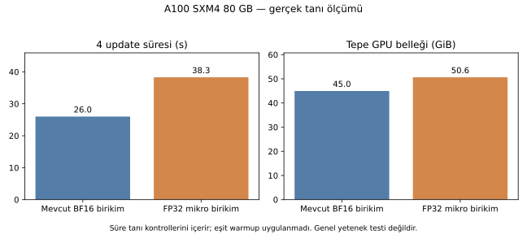
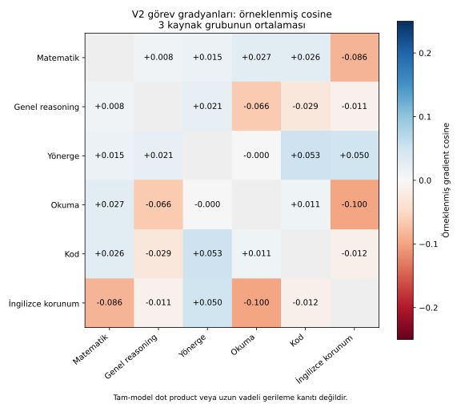

# İlk gerçek GPU tanısı — tamamlandı

19 Ekim 2026. Yetkilendirilen sınır **$2 /1 saat**. Instance **56737582**, A100 SXM4 80GB, saatlik **$0,964815**. İki precision kolu ve6-aile gradient tanısı tamamlandı. Sonuçlar/ağırlıklar yedeklenip hash doğrulandı; GPU **14:06:54 UTC** tarihinde silindi. Yeniden API kontrolünde açık instance yok. Kiralamadan doğrulanmış silmeye **486,8 saniye**, yaklaşık8,1 dakika.

14:14 UTC son kontrol bakiyesi **$11,20487**, başlangıç **$11,38732**; gözlenen fark **yaklaşık$0,18**. Bu bakiye farkıdır; fatura kalemleri değildir ve geç tahakkuk gelebilir. Bir saat veya$2 sınırına yaklaşılmadı. Biten watchdog timer kapatıldı.

## 1. Deney ve kaynak doğrulaması

V2 sabit revision `c8ee3888c486fa49d8d9e798a632c9f7ce664d7a`, `checkpoints/final`. On dosyanın **büyük ağırlık payloadları dahil** SHA256/boyut kontrolü GPUda geçti. Mamba cached-update kernel ön kontrolü, BF16 working parametre koşulu ve V2 tied embedding/output-head ortak pointer koşulu geçti. Torch2.5.1+cu121 / Transformers4.56.1 / bitsandbytes0.48.1.

Aynı128 eski train örneği, aynı sıra/seed, aynı assistant-token objective ağırlığı, micro1×accum32, LR7.5e-7, AdamW8bit, FP32 masters. Her kol ayrı aynı checkpointten4 update. Toplam **8 tanı optimizer güncellemesi**; yeni kapsamlı SFT veya production modeli değildir. Mikro gradyan hesaplaması iki kolda da BF16; B yalnız mikro-batchler arasındaki toplamı FP32 tutar.

## 2. Precision sonucu

| Ölçüm | A: mevcut BF16 birikim | B: FP32 mikro birikim |
|---|---:|---:|
|4 update süresi|25,998s|38,291s|
|Tepe allocated GPU belleği|44,965GiB|50,627GiB|
|Tepe reserved GPU belleği|46,059GiB|51,490GiB|
|Giriş tokenı/sn, tanı dahil|3066,7|2082,1|
|Assistant tokenı/sn, tanı dahil|1512,8|1027,1|
|İlk adım loss|1,09663843|1,09663843|
|İlk adım tam pre-clip norm|2,614285|2,614602|

İlk adım aynı başlangıç ağırlıklarıyla462 parametre tensorunun örneklenmiş koordinatlarında:

- Birleştirilmiş sample gradient cosine **0,999909**.
- Göreli L2 farkı **%1,349**.
- Tensor başına medyan göreli L2 farkı **%1,223**; en yüksek **%5,763**.
- En düşük tensor cosine **0,999050**.

Bu, BF16 mikro toplamıyla FP32 mikro toplamının gerçek modelde farklı gradient verdiğiyle uyumlu **sayısal kanıttır**. “Model kapasitesinin%1,35'i kayboldu” veya “tarihsel math kaybının nedeni budur” demek değildir. Bunlar tam gradient dot productları değil, tensor başına deterministik koordinat örnekleridir. Aynı-kol tekrar/kaydedilmiş mikro-gradient replay kontrolü yok; kernel nondeterminizmi ayrıca ayrıştırılmadı. İleriki3 adımda modellerin working ağırlıkları ayrıştığı için farkı yalnız toplama işlemine bağlayamayız.

Çalışan bu B uygulaması **%47,3 daha uzun** ve **+5,66GiB** peak allocated bellek kullandı. Süre tanı örnekleme/validasyon işlemlerini içerir; eşit warmup yapılmadı ve ilk kol derleme/cache etkileri ayrı ölçülmedi. B ayrıca her mikro-batchte finite kontrolü yapıyor. Dolayısıyla genel steady-state training overheadı veya mimari alt sınır diye sunulmaz. Bu maliyetle henüz **production runtime B'ye geçirilmedi**.

İlk adımda tensor başına ortalama sampled BF16 working değişmeme oranı iki kolda da yaklaşık%99,60. FP32 master güncellemeleri büyük ölçüde sıfırdan farklı. Bu oran “eğitim işlemiyor” anlamına gelmez: sub-BF16 adımlar masterlarda birikir; aynı işlemde working yuvarlaması ayrı olaydır. BF16 checkpoint exportunun optimizer/master resume durumu taşımadığı ayrıca kayıtlıdır.

## 3. Görev gradyanları

Değişmemiş V2 üzerinde6 aile×3 ayrı stored grup;18 backward; optimizer güncellemesi yok. Süre **10,41s**, peak **22,23GiB**. Mamba/attention/feed-forward/embedding/other normları ve sampled cosine; tied head bağımsız parametre olmadığı için ayrıca doldurulmadı.

| Çift | Üç sample cosine | Ortalama | Yorum |
|---|---|---:|---|
|Yönerge–math|+0,0696 /−0,0906 /+0,0674|+0,0155|Bu örneklerde tutarlı negatif yön yok |
|Okuma–reasoning|−0,0744 /−0,0356 /−0,0882|−0,0660|Üçünde de negatif; takip edilmeli |
|English retention–math|−0,1788 /−0,0549 /−0,0229|−0,0856|Üçünde de negatif; takip edilmeli |
|English retention–okuma|−0,0790 /+0,0084 /−0,2281|−0,0996|Değişken; tek başına genelleme yok |

**PCGrad etkinleştirilmedi.** Bazı tekrarlanan negatif yönler var; ama yalnız üç örnek, koordinat örneklemesi ve uzun vadeli görev doğruluğu ölçülmeden tarihsel regresyonun nedenini kanıtlamaz. Yönerge–math için bu tanı, basit “her zaman birbirini bozuyorlar” açıklamasını desteklemiyor; daha geniş veri/kümülatif optimizer etkisini dışlamıyor.

Dil ve veri kapsamı özellikle sınırlı: instruction ve reading kaynakları İngilizce SmolTalk; math Türkçe GSM8K; reasoning Türkçe distilled science; code Türkçe distilled code. English retention general/math/reading karışımıdır. Bu yüzden “yalnız dilin etkisi” diye yorumlanamaz. Doğal Türkçe dialogue ve English code hâlâ eksik. Kaynak/group/token metadatası [gradient_case_provenance.json](results/pilot_20261019/gradient_case_provenance.json); ham istem/yanıtlar Git'te yok.

## 4. Sonraki karar

1. **Yeni büyük SFT başlatma.** Hiçbir capability benchmarkı bu deneyde yeniden ölçülmedi; kalite kazancı veya kabul edilmiş yeni model yok.
2. FP32 mastersı koru. Mikro birikim farkı gerçek bir araştırma değişkenidir; fakat bu implementationın maliyeti ve ölçülmemiş görev yararı nedeniyle production geçişi yapma. Gelecekte bu yol denenirse gereksiz senkron finite kontrolleri ayrı, eşit-warmup ölçümüyle ele alınabilir.
3. Öncelik eksik doğal TR dev/semantic kontroller ve gerçek kaynak/assistant-token çeşitliliği. Sonra V2/V5 ve dört basit merge adayı; başarılı merge yeni SFT ihtiyacını kaldırabilir.
4. Daha geniş gruplarda çatışma tekrarlanıp dev kaybıyla tutarlı olursa equal-data/equal-cost PCGrad pilotu düşün; bu ölçüme dayanarak otomatik yeni optimizer veya DPO açma.

## 5. Kalıcı kanıtlar

- [Makine tarafından okunabilir özet](results/pilot_20261019/summary.json), [tam gradient tanısı](results/pilot_20261019/interference.json), [462 tensorun ilk adım karşılaştırması](results/pilot_20261019/first_step_parameter_comparison.json).
- Private Hub: `serda-dev/Jamba2-3B-Capability-Pilot-20261019`.
- A ağırlık revisionı `b3008780d22ad31a122b1bca237fee84bb0fbb11`, `checkpoints/precision_existing`.
- B ağırlık revisionı `3d5e5170a416ba2dcfe591d65ad23d886e69fc78`, `checkpoints/precision_fp32_micro`.
- İki checkpoint receiptinin dosya boyut/hashleri VPSden bağımsız API kontrolüyle tekrar doğrulandı. Optimizer/FP32 master state kaydedilmedi; **exact optimizer resume yok**.
- Raw precision raporu117MB olduğundan Git'e alınmadı; private log arşivinde. Arşiv revisionı `31408439c701036ff65554fe6a3c5a0b66c7ae29`, SHA256 `b999e1ef6c58836a51d487018260d15e3638ba82aae3a895f4d48fc7d5335fb7`. VPS dosya hash kontrolü geçti.
- [Kapanış ve maliyet receiptı](results/pilot_20261019/completion.json). VPS kökü `/home/serda/capability-pilot-20261019`.
- Yeniden analiz: `python -m research.capability_recovery.summarize_pilot --precision RAW_PRECISION.json --interference RAW_INTERFERENCE.json --output summary.json`; görseller `plot_pilot.py` ile yeniden üretilebilir.

İlk54677825 teklifi kiralama anında `no_such_ask` ile reddedildi; instance/ücret oluşmadığı doğrulandı. CLI'nın raw hata JSONunu stderrde ve exit0 ile döndürebildiği görüldü; pilot adapterı düzeltildi. Başarılı rent yanıtlardaki kimlik bilgileri receiptlere yazılmaz. Hiçbir production checkpointi, test eşiği veya public ağırlık değiştirilmedi.
